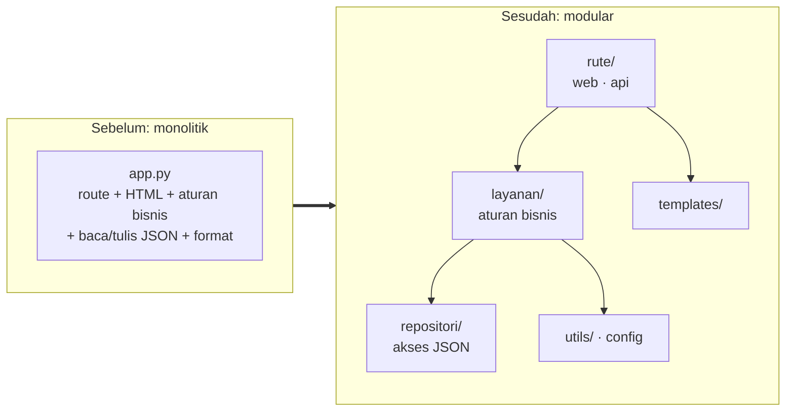
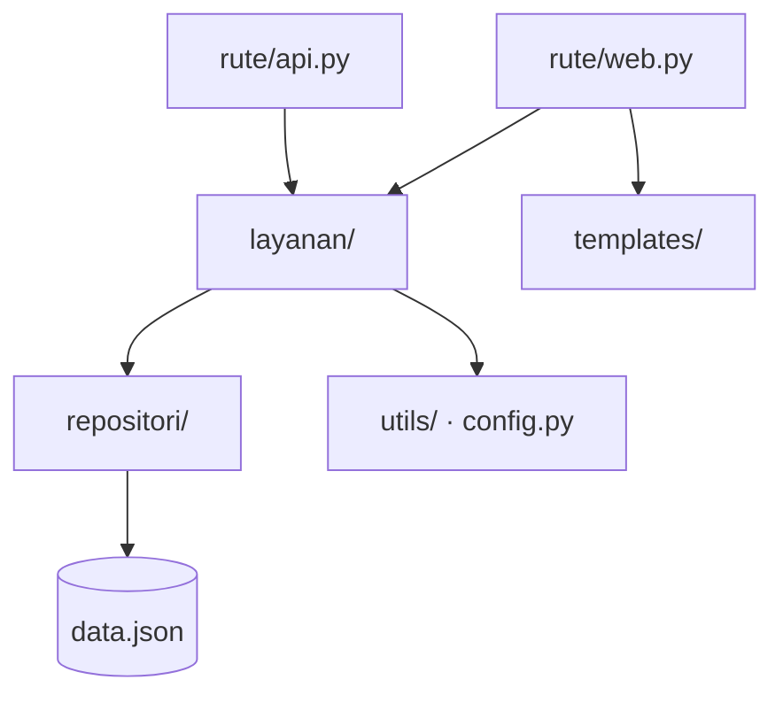
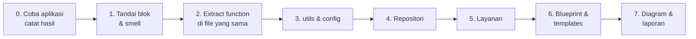

# Tugas — Modularisasi Aplikasi Monolitik

**Mata Kuliah**: Konstruksi & Rekayasa Perangkat Lunak
**Sifat**: Tugas lanjutan Pertemuan 4 (Desain Perangkat Lunak). Pembagian aplikasi ditentukan dosen.
**Stack**: Python · Flask · data JSON · Docker Compose

---

## Latar Belakang

Ketujuh aplikasi di folder ini **berjalan dengan benar**, tetapi seluruh kodenya ditumpuk di satu file `app.py`. Akses file JSON, aturan bisnis, validasi, HTML, dan API bercampur di dalam fungsi route; banyak blok kode ditulis ulang di beberapa tempat.

Tugas Anda: **pecah logika aplikasi menjadi fungsi dan modul tanpa mengubah perilakunya**. Terapkan konsep Pertemuan 4: modularitas, *information hiding*, *cohesion* tinggi, *coupling* rendah, dan prinsip SOLID.



### Tahapan Tugas

| Tahap | Fokus | Status |
|-------|-------|--------|
| **1. Modularisasi** | Memecah logika menjadi fungsi dan modul | **Tugas ini** |
| 2. Unit test | Menguji fungsi-fungsi hasil modularisasi | Tugas lanjutan (diberikan kemudian) |

Fungsi yang dipecah dengan baik di tahap 1 akan mudah diuji di tahap 2.

---

## Tujuh Aplikasi

| No | Folder | Aplikasi | Tipe aplikasi | Port |
|----|--------|----------|---------------|------|
| 1 | [`kasir-toko`](kasir-toko/) | Kasir Toko | Point of Sale (ritel) | 5001 |
| 2 | [`perpustakaan`](perpustakaan/) | Perpustakaan Kampus | Sirkulasi / inventaris | 5002 |
| 3 | [`reservasi-klinik`](reservasi-klinik/) | Reservasi Klinik | Booking / penjadwalan | 5003 |
| 4 | [`dompet-keuangan`](dompet-keuangan/) | Dompet Mahasiswa | Keuangan pribadi | 5004 |
| 5 | [`tiket-event`](tiket-event/) | Tiket Event Kampus | E-ticketing | 5005 |
| 6 | [`kuis-online`](kuis-online/) | Kuis Online | E-learning / penilaian | 5006 |
| 7 | [`donasi-zis`](donasi-zis/) | Donasi ZIS & Wakaf | Filantropi / kalkulator | 5007 |

Setiap aplikasi punya **8–11 aturan bisnis** (lihat `README.md` di folder masing-masing). Saat ini semua aturan itu tertulis langsung di dalam route, dan itulah bahan yang dipecah menjadi fungsi dan modul.

---

## Memulai: Fork, Clone, dan Ambil Aplikasi Kelompok Anda

Repo tugas: **https://github.com/tazkia-tech/tugas-modularisasi-aplikasi**

Setiap kelompok **hanya mengerjakan satu aplikasi** sesuai pembagian dosen. Aplikasi lain **tidak perlu dikerjakan** dan boleh dihapus dari repo Anda.

### 1. Fork, lalu clone

1. Buka repo tugas di GitHub, klik **Fork**, dan buat fork di akun salah satu anggota kelompok.
2. Undang anggota kelompok lain sebagai *collaborator*: **Settings → Collaborators → Add people**.
3. Clone fork tersebut (bukan repo dosen):

```bash
git clone https://github.com/<akun-anda>/tugas-modularisasi-aplikasi.git
cd tugas-modularisasi-aplikasi
```

### 2. Sisakan hanya aplikasi kelompok Anda

Contoh untuk kelompok **Perpustakaan**: hapus enam aplikasi lainnya.

```bash
git rm -r -q kasir-toko reservasi-klinik dompet-keuangan tiket-event kuis-online donasi-zis
```

Lalu buka `docker-compose.yml` di folder utama dan **hapus baris `include`** milik aplikasi yang sudah dihapus. Kalau tidak, `docker compose` di folder utama akan error karena file yang dirujuk tidak ada. Untuk kelompok Perpustakaan, hasilnya:

```yaml
include:
  - perpustakaan/docker-compose.yml
  - contoh-laundry-kiloan/sebelum/docker-compose.yml
  - contoh-laundry-kiloan/sesudah/docker-compose.yml
```

Folder `contoh-laundry-kiloan/` sebaiknya **disimpan** sebagai rujukan selama mengerjakan. Kalau tidak dipakai, boleh juga dihapus beserta dua baris `include`-nya.

### 3. Simpan dan kirim ke fork Anda

```bash
git add -A
git commit -m "Ambil aplikasi perpustakaan untuk kelompok"
git push
```

Setelah itu kerjakan modularisasi **di fork Anda**. Sebaiknya buat satu commit per langkah (lihat [Langkah Pengerjaan](#langkah-pengerjaan)).

> **Jangan** membuat *pull request* ke repo dosen. Yang dikumpulkan adalah link fork kelompok Anda.

---

## Menjalankan

Setiap aplikasi punya **`docker-compose.yml` sendiri** di foldernya. Kerjakan dan jalankan dari folder aplikasi Anda:

```bash
cd tugas-modularisasi-aplikasi/<folder-aplikasi-anda>    # misalnya perpustakaan
docker compose up --build        # → http://localhost:<port> (lihat tabel di atas)
```

- Folder aplikasi di-*mount* ke container, jadi perubahan kode langsung terbaca tanpa build ulang. Build ulang hanya bila `requirements.txt` berubah.
- Data contoh berubah setiap kali Anda mencoba transaksi. Kembalikan dengan `git checkout -- data.json`.
- Tanpa Docker: `python -m venv .venv`, `pip install -r requirements.txt`, `python app.py` (port 5000).
- `docker compose up --build` dari folder utama menjalankan semua aplikasi yang masih tercantum di `include` (aplikasi Anda dan contoh Laundry).

---

## Aturan Main

1. **Perilaku tidak boleh berubah.** URL, format JSON, pesan error, dan angka hasil harus sama persis.
   - Cara mengecek: jalankan **Cek Cepat** di `README.md` aplikasi Anda sebelum dan sesudah, lalu bandingkan hasilnya.
   - Coba juga halaman web-nya di browser.
2. **`docker compose up` harus tetap berjalan** untuk aplikasi Anda.
3. Bila menemukan **bug atau inkonsistensi** (misalnya web dan API memperlakukan input berbeda), **catat di laporan**. Jangan diperbaiki diam-diam.
   - Bila penyatuan logika web dan API membuat salah satunya berubah, tulis sebagai **keputusan desain** beserta alasannya.

---

## Cara Memecah Logika Menjadi Fungsi

Inti tugas ini. Gunakan empat pertanyaan berikut untuk setiap blok kode di dalam route.

| No | Pertanyaan | Jika "ya" |
|----|------------|-----------|
| 1 | Apakah blok ini menjalankan **satu aturan bisnis** yang bisa disebut namanya? (hitung diskon, hitung denda, cek kuota) | Jadikan **satu fungsi** dengan nama kata kerja: `hitung_diskon`, `hitung_denda` |
| 2 | Apakah blok yang sama (atau mirip) **ditulis di lebih dari satu tempat**? | Satu fungsi, **dipanggil** dari semua tempat itu |
| 3 | Apakah blok ini memakai `request`, `jsonify`, atau menghasilkan HTML? | Pisahkan: **rute** mengurus HTTP/HTML, **fungsi layanan** hanya menerima nilai dan mengembalikan hasil |
| 4 | Apakah ada **angka aturan** (0.11, 50000, 85) di dalam blok? | Pindahkan ke **`config.py`** sebagai konstanta bernama |

### Ciri Fungsi yang Baik

- **Satu tanggung jawab.** Bila namanya butuh kata "dan" (`hitung_diskon_dan_simpan`), pecah lagi.
- **Masukan lewat parameter, keluaran lewat `return`.** Tidak membaca `request`, tidak memakai variabel global.
- **Nama menjelaskan isi**: `biaya_simpan(estimasi, tgl_diambil)` lebih jelas daripada `proses(d, x)`.
- **Pendek.** Umumnya di bawah 20 baris.

### Contoh: Tarif & Berat Minimal di Laundry Kiloan

Contoh ini memakai aplikasi contoh [`contoh-laundry-kiloan/`](contoh-laundry-kiloan/), bukan salah satu aplikasi tugas.

**Sebelum.** Aturan yang sama ditulis di route web `/nota` (baris 55–62 `sebelum/app.py`) **dan** di route `/api/nota` (baris 161–163), dengan gaya yang berbeda:

```python
# route web /nota
if layanan == "cuci_kering":
    tarif = 7000
elif layanan == "cuci_setrika":
    tarif = 9000
else:
    tarif = 6000
berat_ditagih = berat if berat > 3 else 3
harga_dasar = round(berat_ditagih * tarif)

# route API /api/nota
tarif = {"cuci_kering": 7000, "cuci_setrika": 9000, "setrika": 6000}[layanan]
berat_ditagih = max(berat, 3)
harga_dasar = round(berat_ditagih * tarif)
```

**Sesudah.** Angka aturan pindah ke config, dan setiap aturan menjadi satu fungsi kecil:

```python
# config.py
TARIF_PER_KG = {"cuci_kering": 7000, "cuci_setrika": 9000, "setrika": 6000}
BERAT_MINIMAL_DITAGIH = 3       # kg
```

```python
# layanan/harga.py
from config import BERAT_MINIMAL_DITAGIH, TARIF_PER_KG

def berat_ditagih(berat: float) -> float:
    """Cucian di bawah berat minimal tetap ditagih berat minimal."""
    return max(berat, BERAT_MINIMAL_DITAGIH)

def harga_dasar(layanan: str, berat: float) -> int:
    return round(berat_ditagih(berat) * TARIF_PER_KG[layanan])
```

Route web dan API **memanggil fungsi layanan yang sama** (`buat_nota`), dan fungsi itulah yang memakai `harga_dasar`:

```python
# rute/web.py
n = buat_nota(_repo(), nama, hp, layanan, berat, express, date.today())

# rute/api.py
n = buat_nota(_repo(), b.get("nama", ""), b.get("hp", ""), b.get("layanan"), b.get("berat", 0), express, tanggal)
```

Hasilnya:
- Tarif dan berat minimal kini punya **satu tempat**. Menambah layanan baru (misalnya `dry_clean`) cukup satu baris di `config.py`.
- `harga_dasar` **tidak tahu** soal Flask, HTML, atau file JSON. Fungsi seperti ini yang nanti diuji di tahap 2.

Pemecahan lengkapnya ada di [`contoh-laundry-kiloan/README.md`](contoh-laundry-kiloan/README.md).

---

## Contoh Lengkap: Laundry Kiloan (Sebelum & Sesudah)

Folder [`contoh-laundry-kiloan/`](contoh-laundry-kiloan/) berisi **satu aplikasi contoh di luar ketujuh aplikasi tugas**, dalam dua versi dengan perilaku yang sama:

| Folder | Isi | Jalankan |
|--------|-----|----------|
| `sebelum/` | Monolitik: satu `app.py` (226 baris) | `docker compose up --build` → http://localhost:5008 |
| `sesudah/` | Modular: `config.py`, `repositori/`, `layanan/` (14 fungsi), `rute/`, `templates/` | `docker compose up --build` → http://localhost:5009 |

Isi [`README.md`](contoh-laundry-kiloan/README.md) contoh ini:
- daftar masalah di versi monolitik, lengkap dengan nomor barisnya;
- **peta perubahan** (blok lama → fungsi baru → modul → alasan), yang bentuknya sama dengan tabel yang Anda buat di laporan;
- satu contoh lengkap (biaya simpan) dari dua salinan kode di route menjadi satu fungsi;
- pencocokan dengan kriteria minimal tugas.

Pakai contoh ini sebagai **pola**, bukan untuk disalin. Aplikasi tugas Anda punya aturan bisnis yang berbeda.

---

## Struktur Target (boleh disesuaikan, dengan alasan)

```
nama-aplikasi/
├── app.py              # hanya membuat app & mendaftarkan blueprint:  app = create_app()
├── config.py           # lokasi data dan konstanta aturan bisnis (tarif, batas, persen, ...)
├── repositori/         # SATU-SATUNYA bagian yang tahu bahwa data disimpan di file JSON
├── layanan/            # aturan bisnis: TANPA import flask, request, jsonify, HTML
├── rute/
│   ├── web.py          # blueprint halaman HTML
│   └── api.py          # blueprint /api/...
├── templates/          # HTML dipindah dari string Python ke file .html
├── utils/              # format rupiah, tanggal, dll.
└── data.json · Dockerfile · docker-compose.yml · requirements.txt
```



**Arah ketergantungan hanya ke bawah.** Layanan tidak boleh mengimpor rute; repositori tidak boleh tahu tentang HTTP.

### Kriteria Minimal

| No | Kriteria | Cara mengecek |
|----|----------|---------------|
| 1 | **≥ 8 fungsi layanan** bernama jelas, masing-masing satu tanggung jawab | Baca `layanan/` |
| 2 | Kode baca/tulis JSON **hanya ada di repositori** | Cari `json.load` / `json.dump` |
| 3 | **Tidak ada HTML** di file `.py` | Cari `<html` di file `.py` |
| 4 | Web dan API **memanggil fungsi layanan yang sama**, tidak menyalin logika | Bandingkan `web.py` dan `api.py` |
| 5 | **Tidak ada magic number** aturan bisnis di luar `config.py` | Cari angka seperti `0.11`, `50000`, `85` |
| 6 | Modul `layanan/` **tidak mengimpor Flask** | Cari `flask` di `layanan/` |
| 7 | Perilaku sama dan aplikasi jalan di Docker | Cek Cepat di README memberi hasil yang sama |

---

## Langkah Pengerjaan

Kerjakan **bertahap**. Setelah **setiap** langkah, jalankan aplikasi dan Cek Cepat. Sebaiknya buat satu commit per langkah.



0. **Coba aplikasi.** Jalankan, coba setiap halaman, lalu jalankan Cek Cepat dan **simpan hasilnya** sebagai pembanding.
1. **Baca dan tandai.** Beri komentar pada setiap blok logika: aturan apa, ditulis di mana saja, dan smell apa (duplikasi, magic number, fungsi terlalu panjang, HTML inline, file tidak ditutup, state global).
2. **Extract function** di `app.py` dulu. Mulai dari yang paling sering diulang (format rupiah, baca/tulis JSON), lalu aturan bisnis.
3. Pindahkan fungsi bantu ke **`utils/`** dan konstanta ke **`config.py`**.
4. Buat **repositori**: fungsi atau kelas untuk ambil dan simpan data. Rute dan layanan tidak lagi tahu ada file JSON.
5. Pindahkan aturan bisnis ke **`layanan/`**. Fungsi menerima data biasa dan mengembalikan hasil/error, tanpa `request` dan `jsonify`.
6. Pecah route menjadi **blueprint** `web` dan `api`, lalu pindahkan HTML ke **`templates/`**. Isi `app.py` tinggal `create_app()`.
7. Gambar **diagram modul** dan tulis laporan.

---

## Luaran

1. **Kode modular**: **link fork GitHub kelompok Anda** yang berisi folder aplikasi yang sudah dipecah. Riwayat commit ikut dinilai sebagai bukti pengerjaan bertahap.
2. **Laporan singkat (2–4 halaman)** berisi:
   - **Peta perubahan**: tabel *blok kode lama → fungsi baru → modul* (minimal 8 baris)

     | Blok di `app.py` lama | Fungsi baru | Modul |
     |-----------------------|-------------|-------|
     | Pilih tarif & berat minimal, baris 55–62 dan 161–163 *(contoh Laundry)* | `harga_dasar(layanan, berat)` | `layanan/harga.py` |
   - **Diagram modul** dan arah ketergantungannya (Mermaid, draw.io, atau gambar tangan yang difoto)
   - **Analisis desain**:
     - di mana *cohesion* naik dan *coupling* turun;
     - prinsip SOLID mana yang diterapkan, beserta contoh kodenya;
     - informasi apa yang disembunyikan (*information hiding*).
   - **Temuan**: smell, bug, atau inkonsistensi yang ditemukan, serta keputusan yang diambil
3. **Bukti**: hasil Cek Cepat sebelum dan sesudah (tangkapan layar), serta aplikasi berjalan lewat `docker compose`

---

## Kriteria Penilaian

| Aspek | Bobot | Yang dinilai |
|-------|-------|--------------|
| Pemecahan fungsi | 30% | Setiap aturan bisnis menjadi fungsi sendiri: satu tanggung jawab, nama bermakna, parameter & `return` (bukan `request`/global), tanpa duplikasi |
| Struktur modul | 25% | Pemisahan rute–layanan–repositori–templates; arah ketergantungan benar; konstanta di `config.py` |
| Perilaku tetap | 15% | Cek Cepat memberi hasil yang sama; aplikasi jalan di Docker |
| Laporan analisis | 30% | Peta perubahan, diagram modul, analisis cohesion/coupling & SOLID, temuan |

---

## Pertanyaan Pemandu

- Jika tarif PPN, denda, atau biaya admin berubah, **berapa file** yang harus diedit sebelum dan sesudah modularisasi?
- Jika data pindah dari JSON ke database, **modul mana saja** yang ikut berubah? Idealnya hanya repositori.
- Bisakah fungsi layanan dipanggil **tanpa menjalankan Flask**, misalnya dari skrip Python biasa?
- Apakah web dan API sekarang **pasti** memakai aturan yang sama?

---

## Mengatasi Masalah

| Gejala | Solusi |
|--------|--------|
| `port is already allocated` | Port 5001–5007 sedang dipakai. Hentikan aplikasi lain atau ubah port kiri di `docker-compose.yml` aplikasi Anda |
| `all predefined address pools have been fully subnetted` | Terlalu banyak network Docker lama: jalankan `docker network prune` |
| `ModuleNotFoundError` setelah memecah file | Jalankan dari folder aplikasi, dan pastikan setiap folder modul punya `__init__.py` |
| `ImportError` / *circular import* | Arah impor harus satu arah: rute → layanan → repositori |
| Perubahan template tidak muncul | Pastikan folder `templates/` berada di tempat yang dicari Flask (`Flask(__name__)` atau `Blueprint(..., template_folder=...)`) |
