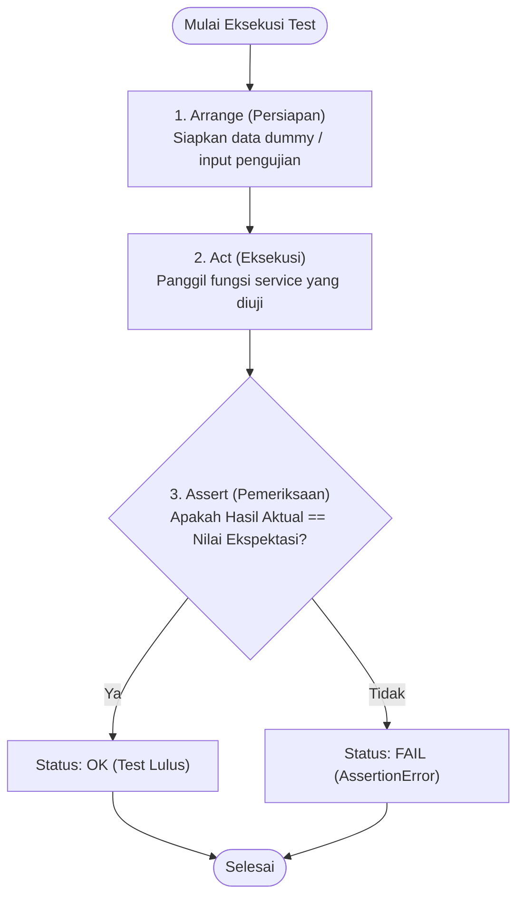
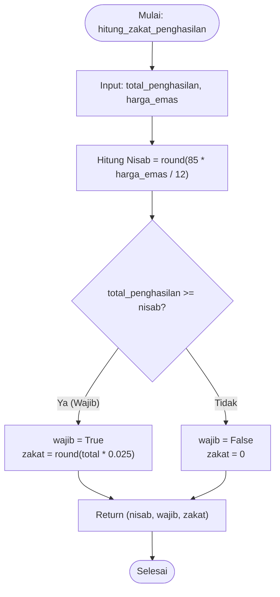
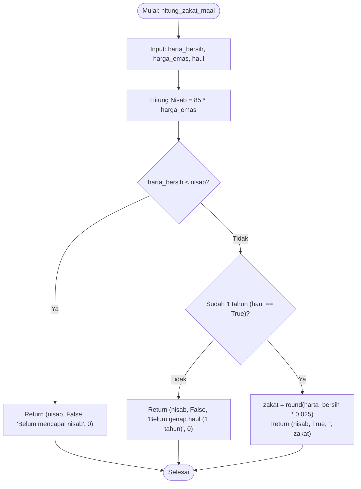
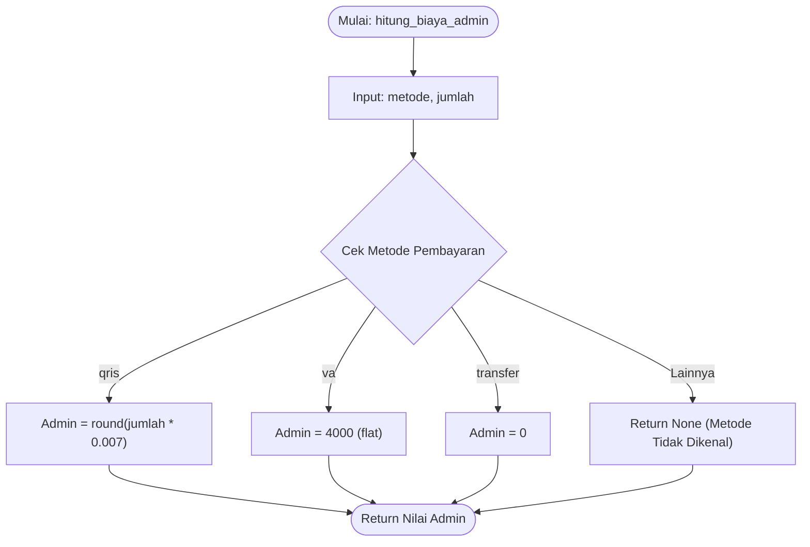
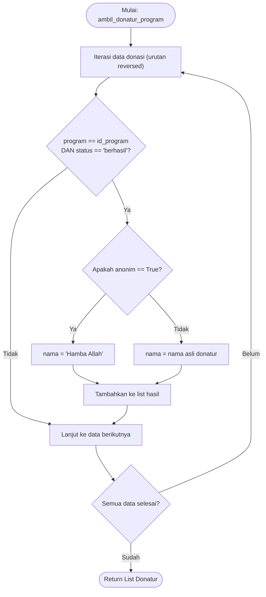
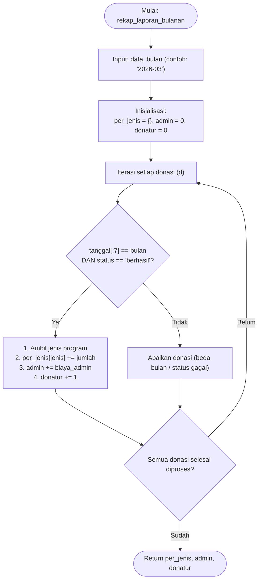

# 🧪 Unit Testing Aplikasi Donasi & ZIS

Dokumentasi ini berisi panduan dan penjelasan mengenai pengujian unit (*unit testing*) pada projek aplikasi Donasi, Zakat, dan Laporan. Pengujian dibuat menggunakan modul bawaan Python `unittest` untuk menguji logika bisnis secara terisolasi tanpa mengubah data asli.

---

## 📂 Struktur Projek (Folder Tree)

```text
donasi-zis/
│
├── services/                     # Modul logika bisnis utama
│   ├── __init__.py
│   ├── storage.py                # Pembacaan dan penyimpanan data JSON
│   ├── donasi_service.py         # Logika transaksi donasi & perhitungan admin
│   ├── zakat_service.py          # Logika kalkulasi nisab & zakat
│   └── laporan_service.py        # Logika rekapitulasi laporan bulanan
│
├── tests/                        # Folder khusus pengujian unit
│   ├── __init__.py
│   ├── README.md                 # Dokumentasi pengujian & flowchart
│   ├── images/                   # Folder penampung screenshot hasil test
│   │   ├── Screenshot 2026-11-07 105652.png
│   │   └── Screenshot 2026-11-07 113044.png
│   ├── test_donasi_service.py    # Pengujian modul donasi
│   ├── test_zakat_service.py     # Pengujian modul zakat
│   └── test_laporan_service.py   # Pengujian modul laporan
│
└── data.json                     # Database lokal (JSON)
```

---

## 🚀 Cara Menjalankan Pengujian

Jalankan perintah berikut di terminal pada direktori `donasi-zis`:

```bash
# Menjalankan pengujian zakat saja
python -m unittest tests.test_zakat_service -v

# Menjalankan pengujian donasi saja
python -m unittest tests.test_donasi_service -v

# Menjalankan pengujian laporan saja
python -m unittest tests.test_laporan_service -v

# Menjalankan seluruh pengujian unit sekaligus
python -m unittest discover -s tests -t . -v
```

---

## 📊 Flowchart Logika Pengujian

### 1. Alur Kerja Siklus Unit Test (Arrange - Act - Assert)
Siklus standar yang digunakan pada setiap fungsi pengujian untuk memverifikasi kebenaran logika:



---

### 2. Logika Modul Zakat (`test_zakat_service.py`)

#### A. Zakat Penghasilan (`hitung_zakat_penghasilan`)


#### B. Zakat Maal (`hitung_zakat_maal`)


---

### 3. Logika Modul Donasi (`test_donasi_service.py`)

#### A. Perhitungan Biaya Admin (`hitung_biaya_admin`)


#### B. Filter dan Penyamaran Donatur Anonim (`ambil_donatur_program`)


---

### 4. Logika Modul Laporan (`test_laporan_service.py`)

#### Rekapitulasi Laporan Bulanan (`rekap_laporan_bulanan`)


---

## 📷 Hasil Eksekusi Unit Test

### 1. Hasil Pengujian Sukses (Semua Test Lulus / OK)


### 2. Hasil Simulasi Pengujian Gagal (Assertion Error)

