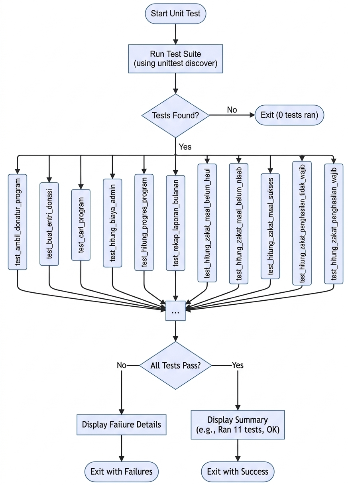

# 🧪 Unit Testing Aplikasi Donasi & ZIS

Dokumentasi ini berisi panduan dan penjelasan mengenai pengujian unit (*unit testing*) pada projek aplikasi Donasi, Zakat, dan Laporan. Pengujian dibuat menggunakan modul bawaan Python `unittest` dan metode *mocking* untuk menguji logika bisnis secara terisolasi tanpa mengubah data asli.

---

## 📂 Struktur Projek (Folder Tree)

```text
donasi-zis/
│
├── services/                     # Modul logika bisnis utama
│   ├── __init__.py
│   ├── storage.py                # Pembacaan dan penyimpanan data JSON
│   ├── donasi_service.py         # Logika transaksi donasi & perhitungan admin
│   ├── zakat_service.py          # Logika kalkulasi nisab & zakat
│   └── laporan_service.py        # Logika rekapitulasi laporan bulanan
│
├── tests/                        # Folder khusus pengujian unit
│   ├── __init__.py
│   ├── images/                   # Folder penampung screenshot hasil test
│   │   └── Screenshot 2026-11-07 105652.png
│   ├── test_donasi_service.py    # Pengujian modul donasi
│   ├── test_zakat_service.py     # Pengujian modul zakat
│   └── test_laporan_service.py   # Pengujian modul laporan
│
└── data.json                     # Database lokal (JSON)

```

##FLOWCHART
!

##HASIL UNITES
!